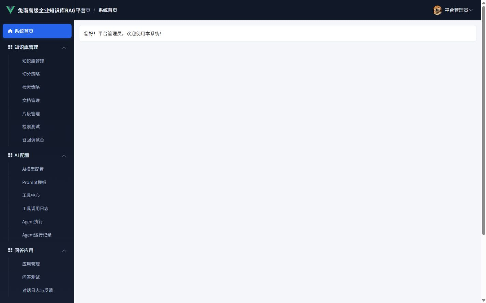
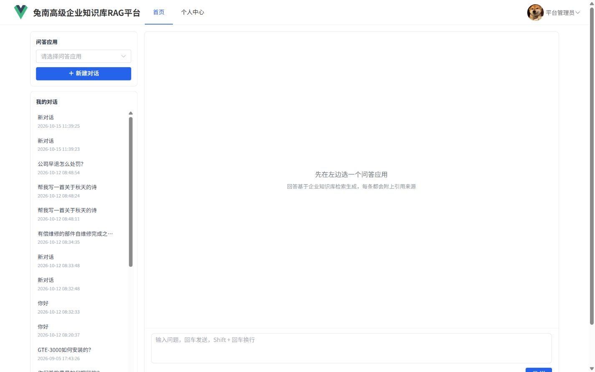

# 兔南高级企业知识库 RAG 平台

一个前后端分离的企业知识库问答平台：把公司制度、产品手册、售后政策等文档灌进知识库，用**混合检索 + 重排**召回依据，再交给大模型生成带引用来源的回答。

管理后台负责知识库与文档维护、模型接入、Agent 工具与效果评测；用户端只面对一个问答窗口。

## 界面预览

管理后台（知识库、文档、检索策略、模型配置、评测看板）：



用户端智能问答（左侧选应用与历史对话，右侧流式回答并附引用来源）：



## 核心功能

| 模块 | 说明 |
| --- | --- |
| 知识库管理 | 知识库 / 文档 / 片段三级维护，支持按文档批量删除、片段人工修正 |
| 文档解析 | PDF、Word、Excel、Markdown、TXT 解析，扫描件走 OCR |
| 切分策略 | 固定长度、按标题、父子分块等多种切分方式，可按知识库配置 |
| 向量化 | 调用向量模型批量生成向量，落库到 PostgreSQL + PGVector |
| 混合检索 | 向量检索 + BM25 关键词检索，两路结果用 RRF 融合 |
| Rerank | 召回结果交给重排模型二次排序，提升 Top-N 准确率 |
| 问句改写 | 支持指代消解、多路改写等策略，解决"它/这个型号"指代问题 |
| Agent | 基于 LangGraph，把知识库检索、函数工具编排成可回溯的执行流程 |
| 问答应用 | 一个应用 = 一组知识库 + 一套检索策略 + 一种问答模式，流式输出 |
| 效果评测 | 评测集管理、批量跑评测、LLM-as-judge 打分、多份报告横向对比 |
| 反馈闭环 | 用户点赞点踩，点踩问题沉淀成新的评测用例 |

## 技术栈

**后端**：Python 3.12 · FastAPI · Tortoise ORM · MySQL 8 · PostgreSQL 18 + PGVector · LangChain / LangGraph · jieba · rank-bm25 · PyMuPDF · RapidOCR

**前端**：Vue 3 · Vite 5 · Element Plus · Vue Router · Axios · ECharts · Marked

**模型**：阿里云百炼（对话 qwen-plus / 向量 text-embedding-v4 / 重排 gte-rerank-v2），走 OpenAI 兼容协议接入

## 目录结构

```
RAG高级企业知识库平台/
├── ai_rag/
│   ├── fastapi-app/            后端服务
│   │   ├── ai/                 文档解析、切分、检索、重排、Agent、评测
│   │   ├── api/                接口层（按业务域拆分）
│   │   ├── service/            业务逻辑层
│   │   ├── models/             Tortoise ORM 模型
│   │   ├── common/             统一返回、异常、鉴权、时间工具
│   │   ├── files/              知识文档与上传文件存放目录
│   │   ├── tests/              pytest 测试
│   │   ├── main.py             服务入口
│   │   ├── settings.py         数据库、JWT 配置
│   │   └── requirements.txt    后端依赖（版本已锁定）
│   └── vue/                    前端工程
│       ├── src/views/manager/  管理端页面
│       ├── src/views/front/    用户端页面
│       └── vite.config.js
├── ai_rag.sql                  MySQL 业务库脚本（25 张表 + 初始化数据）
└── ai_rag_vector.sql           PostgreSQL 向量库脚本（含 110 条向量与 ivfflat 索引）
```

## 快速开始

### 1. 环境要求

- Python 3.12
- Node.js 18+
- MySQL 8.0（业务数据）
- PostgreSQL 18 + pgvector 扩展（向量数据）

### 2. 建库并导入数据

**MySQL 业务库**

```sql
CREATE DATABASE ai_rag DEFAULT CHARACTER SET utf8mb4;
```

```bash
mysql -u root -p ai_rag < ai_rag.sql
```

**PostgreSQL 向量库**

```sql
CREATE DATABASE ai_rag_vector;
```

```bash
# 连到 ai_rag_vector 库再执行，脚本里已含 CREATE EXTENSION vector 和建表语句
psql -U postgres -d ai_rag_vector -f ai_rag_vector.sql
```

> pgvector 扩展需要提前装好；表里的向量维度是 1024，必须与所选向量模型的输出维度一致，否则要重建表并全量重新向量化。

### 3. 改数据库连接配置

打开 `ai_rag/fastapi-app/settings.py`，把两处密码改成你本机的实际密码：

```python
TORTOISE_ORM = { ... "password": "你的 MySQL 密码" ... }   # 业务库
PGVECTOR = { ... "password": "你的 PostgreSQL 密码" ... }  # 向量库
```

### 4. 启动后端

```bash
cd ai_rag/fastapi-app
python -m venv .venv
.venv\Scripts\activate
pip install -r requirements.txt
python main.py
```

服务跑在 `http://localhost:9090`，接口文档在 `http://localhost:9090/docs`。

### 5. 启动前端

```bash
cd ai_rag/vue
npm install
npm run dev
```

前端跑在 `http://localhost:5173`，接口地址在 `.env.development` 里配置。

### 6. 配置模型 Key

数据库脚本里的模型配置只带厂商和模型名，**没有内置 API Key**。启动后进管理后台 ——AI模型配置，把三项配置（对话模型、向量模型、重排模型）的 API Key 填成你自己的百炼 Key，否则检索和问答会报鉴权失败。

## 默认账号

| 账号 | 密码 | 角色 | 用途 |
| --- | --- | --- | --- |
| admin | admin | 管理员 | 管理后台全部功能 |
| zhangsan | 123456 | 普通用户 | 用户端问答 |
| lisi | 123456 | 普通用户 | 用户端问答 |

- 管理后台：`http://localhost:5173/manager/home`
- 用户端：`http://localhost:5173/front/home`

## 说明

- 两个库通过 `knowledge_chunk.id` 关联：业务数据全在 MySQL，向量表只存向量和检索必需的过滤字段（`kb_id`、`document_id`、`chunk_type` 等）。
- 换向量模型必须重建向量表并全量重新向量化，维度不一致写不进去。
- Windows 上后端已经显式指定 `SelectorEventLoop`，因为 psycopg 的异步模式不支持默认的 `ProactorEventLoop`。
